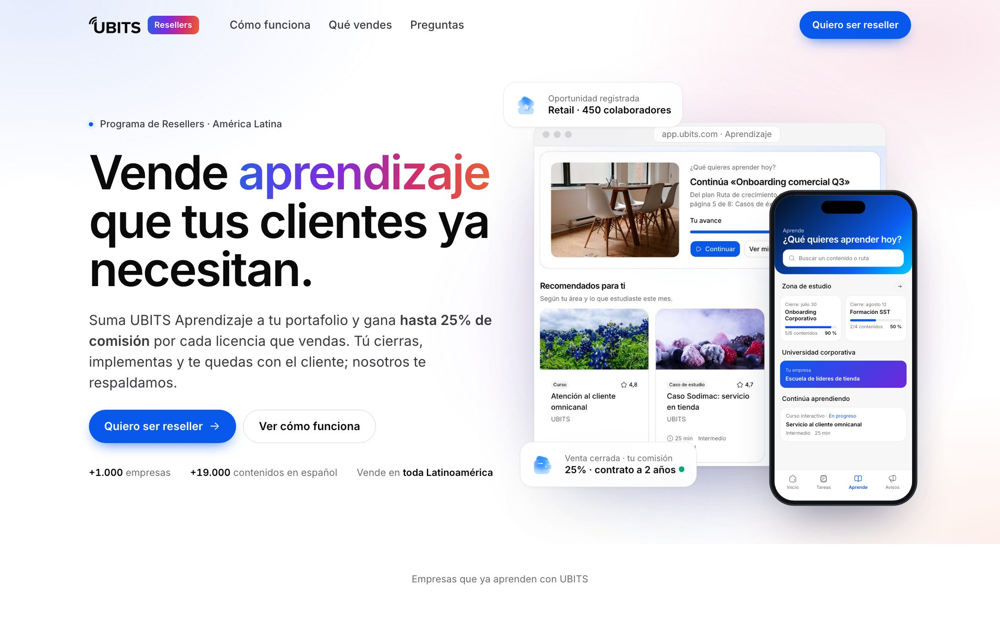
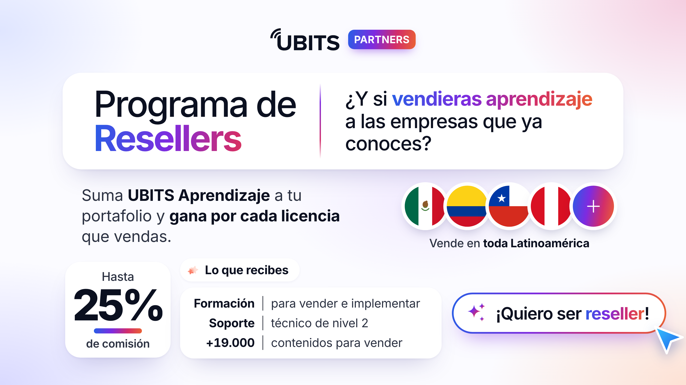
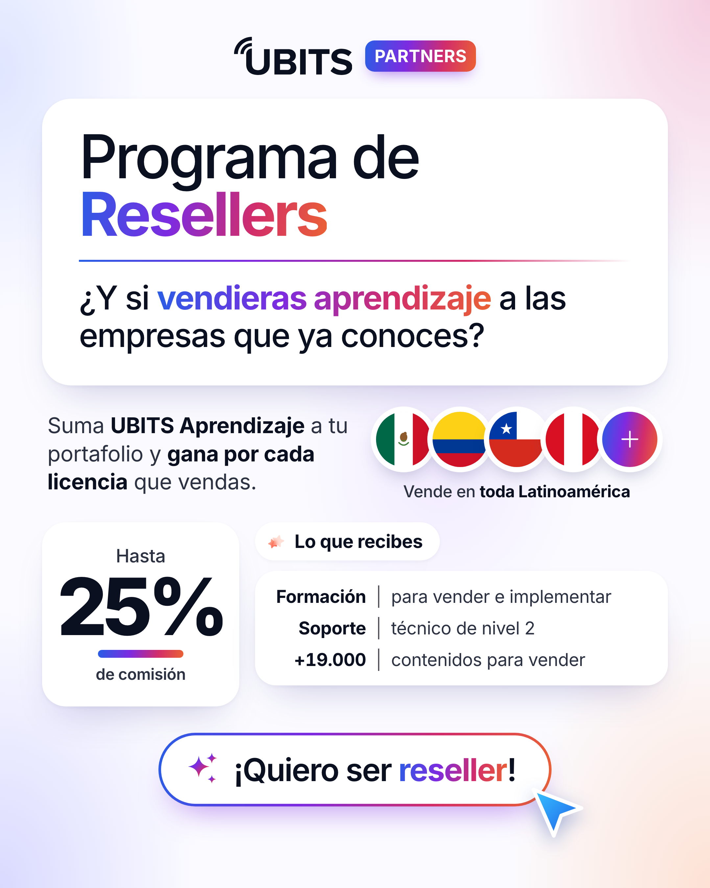
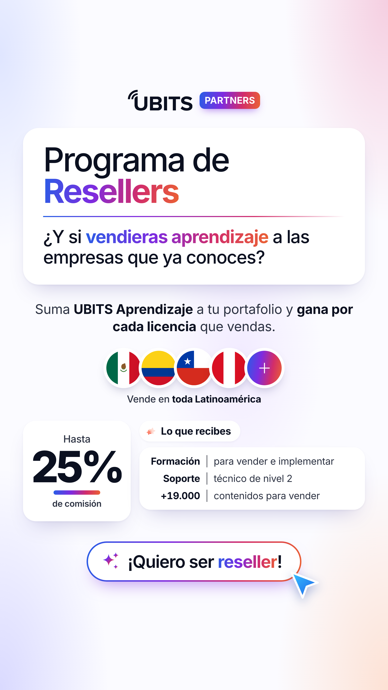

# UBITS · Programa de Resellers

Landing y piezas para redes que invitan a empresas y profesionales de América Latina a **vender UBITS Aprendizaje** y ganar hasta 25 % de comisión por cada licencia.



---

## Qué hay en este repo

| Pieza | Qué es | Dónde está |
|---|---|---|
| **Landing** | Página única con el programa, las comisiones y un formulario para aplicar | [`site/`](site/) |
| **Piezas para redes** | La invitación en 3 formatos: LinkedIn, Instagram e historias | [`redes/export/`](redes/export/) |
| **Textos** | Todos los textos de la landing, de las piezas y de la publicación en redes | [`docs/copies.md`](docs/copies.md) |

<p>
  
  
  
</p>

---

## El mensaje en 30 segundos

Si vas a cambiar cualquier texto, respeta estas cuatro ideas:

- **Qué vende el reseller:** solo **UBITS Aprendizaje**: +19.000 contenidos en español, LMS propio, cursos con IA y app para iOS y Android. No vende Selección, Desempeño ni Encuestas.
- **Cuánto gana:** **20 %** con contrato a 1 año y **25 %** con contrato desde 2 años, sobre el valor efectivamente vendido. Cotiza entre el precio de lista y el precio mínimo de la tarifa de partners.
- **Quién hace qué:** el reseller **cierra su venta, implementa la plataforma** y atiende a su cliente. UBITS lo forma y le da **soporte técnico de nivel 2**.
- **Para quién es:** cualquiera que le venda a empresas, de cualquier industria y tamaño, en **cualquier país de América Latina**, no solo en los 9 donde UBITS ya tiene clientes.

La tabla de precios por usuario **no** se publica: se entrega a cada partner aprobado.

---

## Secciones de la landing

1. **Portada:** "Vende aprendizaje que tus clientes ya necesitan", con el portal y la app.
2. **Logos de clientes** de UBITS.
3. **La oportunidad:** por qué las empresas compran formación.
4. **Qué vendes:** el producto de Aprendizaje.
5. **Lo que ganas:** comisiones de 20 % y 25 % y lo que recibe el reseller.
6. **Cómo funciona:** aplica, conversamos, te formamos, vende, implementa y gana.
7. **Para quién es:** cualquier industria, cualquier tamaño, toda la región.
8. **Preguntas frecuentes.**
9. **Formulario** para aplicar.

---

## Cómo hacer los cambios más comunes

| Quiero… | Qué hago |
|---|---|
| Cambiar un texto de la landing | Editarlo en [`site/index.html`](site/index.html) y anotarlo también en [`docs/copies.md`](docs/copies.md) |
| Cambiar colores, tamaños o espacios | [`site/css/site.css`](site/css/site.css) |
| Cambiar la lista de países del formulario | El campo `name="pais"` en [`site/index.html`](site/index.html) |
| Cambiar las piezas para redes | Editar [`redes/pieza-resellers.html`](redes/pieza-resellers.html) y volver a exportar (ver abajo) |
| Ver quién aplicó | En Netlify: **Forms → resellers** |

---

## Verla en tu computador

Requiere [Bun](https://bun.sh).

```bash
bun tools/serve.js
```

Abre http://localhost:8766. Si envías el formulario, los datos aparecen en la terminal en lugar de guardarse.

---

## Publicar en Netlify

1. En Netlify: **Add new site → Import an existing project → GitHub** y elige este repo.
2. No cambies ninguna configuración: [`netlify.toml`](netlify.toml) ya indica que se publica la carpeta `site/`, sin paso de compilación. Dale **Deploy**.
3. Envía una solicitud de prueba y revisa que llegue a **Forms → resellers**. Ahí puedes activar un aviso por correo para cada solicitud nueva.
4. Cuando tengas el dominio final, cambia `og:image` en `site/index.html` por la dirección completa (`https://tu-dominio/img/og.png`), para que se vea la imagen al compartir el link.

Cada cambio que se sube a `main` se publica solo.

---

## Piezas para redes

Las tres versiones salen de un solo archivo, [`redes/pieza-resellers.html`](redes/pieza-resellers.html):

| Formato | Tamaño | Para |
|---|---|---|
| `?f=land` | 1600 × 900 | LinkedIn, X, YouTube |
| `?f=feed` | 1080 × 1350 | Instagram y LinkedIn en el feed |
| `?f=story` | 1080 × 1920 | Historias de Instagram y estados de WhatsApp |

Después de un cambio, vuelve a exportarlas (necesita Google Chrome):

```bash
bash redes/exportar.sh
```

Los PNG salen a doble resolución en `redes/export/`. El texto sugerido para la publicación está en [`docs/copies.md`](docs/copies.md).

---

## Estructura

```
ubits-resellers/
├── site/                          La landing (lo que publica Netlify)
│   ├── index.html                 Página única
│   ├── gracias.html               Respaldo si el formulario se envía sin JavaScript
│   ├── css/site.css               Estilos
│   ├── js/site.js                 Menú móvil, animaciones y envío del formulario
│   ├── fonts/                     Inter Variable
│   └── img/
│       ├── brand/                 Logo, Bitto, orbe y fondo de marca
│       ├── glass/                 Íconos glass
│       ├── logos/                 Logos de clientes
│       ├── producto/              Captura del portal de aprendizaje
│       └── og.png                 Imagen al compartir el link
├── redes/
│   ├── pieza-resellers.html       Piezas para redes (3 formatos)
│   ├── exportar.sh                Exporta los PNG
│   └── export/                    PNG listos para publicar
├── docs/
│   ├── copies.md                  Todos los textos
│   └── img/                       Imágenes de este README
├── tools/serve.js                 Servidor local de vista previa
└── netlify.toml                   Configuración de Netlify
```

Hecho en HTML, CSS y JavaScript, sin librerías ni compilación.

---

## De dónde sale cada cosa

- **Diseño, colores, fuente, íconos y logos:** del rediseño de ubits.com (repo `ubits-web`).
- **Pantalla de la app:** la sección "Aprende" tal como la reconstruye `ubits-web`, alineada con el código de la app (`app-mobile-ubits`).
- **Captura del portal:** del prototipo de `ubits-web`, recortada para mostrar solo Aprendizaje.
- **Comisiones y reglas de precio:** *Deck Comercial 2026 - Partners*.
- **Cifras de UBITS** (+1.000 empresas, +19.000 contenidos, ISO 27001): del sitio actual y del equipo.

---

## Pendientes

- [ ] Confirmar que unirse al programa no tiene costo (lo dice la sección de preguntas frecuentes).
- [ ] Confirmar el tiempo de respuesta: hoy dice "menos de 2 días hábiles".
- [ ] Confirmar la licencia de los íconos glass (Iconly Pro), igual que en `ubits-web`.
- [ ] Poner la dirección completa de `og:image` cuando exista el dominio.
